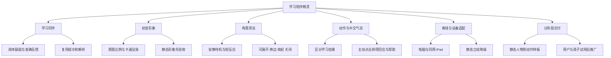

# 学习陪伴精灵：已确认需求基线

确认日期：2026-10-24。用户已逐轮确认本功能讨论的 Q1—Q14，并在 Q15 确认完整汇总准确，可以定稿并记录到项目需求文档。

状态：需求已确认。用户于2026-10-24提出直接使用 `3D/hatsune_miku_v6.glb`，并明确回复“形象确认”。七类独立动作样板已完成，等待用户与孩子试用，尚未接入真实学习流程。进度见[静态人物制作进度](companion-preview-progress.md)与[动作样板](companion-motion-sample.md)。本文是后续设计、开发与验收依据。

本功能沿用[项目总需求](requirements.md)：面向七年级学生家庭自主学习与复习，以练习表现为核心目标；电脑与同网 iPad 优先，日常完全离线，原有判题、提示、解析与成绩记录规则继续适用。

## 1. 定位与需求决策树

精灵是温柔、有活力的学习同伴，帮助学生愿意继续尝试，并提供已有学习与帮助入口。鼓励应与实际发生的学习行为相联系，不能把动画完成、使用提示或查看解析等同于独立答对。

## 2. 形象与建模要求

参考图为 [Hatsune_Miku_V2.png](../images/Hatsune_Miku_V2.png)。采用图中的初音形象，保持修长的原图比例、服装和主要配色，使用接近原图的卡通渲染。

2026-10-24 路线变更：用户反馈程序化重建效果不理想，并指定直接使用 [hatsune_miku_v6.glb](../3D/hatsune_miku_v6.glb)。当前以该 GLB 的实际造型、服装与原始静态姿态作为形象确认对象；PNG 保留为参考。下列造型优先级仍用于检查可读性，不再要求逐项重建 PNG 的轮廓。

静态形象优先检查以下特征：

- 脸部与青色眼睛。
- 长青色双马尾的轮廓、黑粉发饰与耳麦。
- 原图身形比例。
- 白色上衣、青色领带、深色袖套与短裙、长靴等服装轮廓与配色。

单张图片无法确定侧面、背面、头发厚度与服装背面，用户已接受合理的风格化补全。袖口、裙摆等细小装饰可根据实际显示尺寸适度简化。

角落小尺寸与展开查看两种尺寸均需检查辨识度。先由用户确认静态人物，再制作完整动作；静态造型中的问题应在动作制作前解决。

## 3. 学习反馈规则

反馈根据应用确认的新学习结果触发，沿用现有首次独立作答、提示、解析和订正规则。格式错误不消耗首次正式作答；完成题目不能自动视为独立答对。

| 情况 | 文字与表现要求 |
| --- | --- |
| 首次独立答对 | 明确祝贺独立完成，配小幅庆祝 |
| 有效提交后答错 | 温和鼓励，配合已有本题提示，引导继续尝试 |
| 重试订正成功 | 肯定发现问题与改正，表现与首次独立答对有所区别 |
| 使用提示后答对 | 肯定完成，鼓励下一题独立尝试，保留提示使用标识 |
| 查看解析 | 切换为陪看、思考或示意动作，引导理解步骤 |
| 空白或格式错误 | 提醒检查输入格式，不表现为答错 |
| 一轮结束并达标 | 回顾本轮实际结果，给予比单题答对更明显的庆祝 |
| 一轮结束未达标 | 温和回顾，提供返回学习、订正或继续练习的已有入口 |
| 错题复习成功 | 特别肯定这次订正或复习结果，保留原轮成绩 |

五题中至少四题首次独立答对才是“本轮达标”。“本轮达标”不等同于长期掌握；订正、提示后完成和查看解析均不改写原轮首次作答成绩。

精灵求助入口直接复用已有提示与解析，沿用现有使用记录。提交前获得实质提示，必须计入本题提示使用情况，不能通过精灵绕过独立作答统计。

保存失败、断连或尚未确认的结果，不能触发表示已保存、已答对或已达标的反馈。刷新、翻回历史题目或重新读取历史记录，不重复庆祝。

## 4. 台词口吻

采用自然、简短的中文同伴口吻，平时自称“我”、称呼学生“你”。每次一到两句，肯定具体行为；同一场景准备多条台词，减少重复。

示例台词说明口吻，不代表可在所有题型中使用同一数学提示：

| 场景 | 示例 |
| --- | --- |
| 答错后的鼓励 | “我们再检查一步。” |
| 与本题已有提示相符时 | “看看符号有没有变化。” |
| 订正成功 | “你找到问题并改过来了！” |
| 独立答对 | “这题独立完成了，做得不错！” |
| 一轮未达标 | “这轮还有几个地方可以练习，我们从错题里选一道看看。” |

包含数学线索的台词应对应当前题目，并遵循本题已有帮助与记录规则。学生是否理解、是否独立完成，以应用实际记录为依据，不推断应用外的情况。

## 5. 首版动作与表现范围

| 状态 | 已确认表现 |
| --- | --- |
| 待机 | 轻微呼吸、眨眼、双马尾缓慢摆动 |
| 欢迎 | 微笑挥手 |
| 鼓励 | 身体略微前倾，做温和的加油手势 |
| 答对 | 点头、鼓掌等短动作 |
| 订正成功 | 微笑肯定，与首次独立答对的回应有所区别 |
| 查看提示或解析 | 思考、示意查看内容 |
| 一轮达标 | 比单题答对更明显的一次庆祝 |

脸部表情与双马尾摆动均为明确验收项，需分别制作并检查。实际动作应在模型上验证自然程度，不能仅因动画名称、文件或骨骼存在就视为通过。

## 6. 其他首版互动与后续候选

首版包含四项主动或情境互动：

1. 欢迎回来：进入学习时挥手，并提供继续上次学习的入口。
2. 主动求助：点击精灵，可进入当前题目的提示或解析，使用情况照常记录。
3. 错题重逢：复习成功时，特别肯定这次订正。
4. 轻触回应：点击后挥手、点头或说一句简短鼓励。

首版采用预置台词与规则触发，不包含语音或自由 AI 聊天。语音、自由聊天、成长等级、装饰收集、每日任务和休息提醒列为后续候选，是否开展及具体规则另行讨论。

## 7. 显示形式与控制

平时在页面角落显示小尺寸全身人物，保留双马尾轮廓；展开陪伴面板后，可以更清楚地查看人物、阅读气泡与使用互动入口。

提供左右换边、收起和关闭，并提供“减少动作”。相关显示偏好按当前设备记忆。电脑与 iPad 分别适配位置；手机继续遵守项目的基本学习和答题适配要求。

人物、面板、气泡及其周围透明区域不得阻挡题目、公式、提交按钮与数学操作区，也不得截获这些区域所需的点击或拖动。

具体尺寸与布局在样板中通过实际题目和设备验证。

## 8. 触发节奏与动作切换

- 作答期间安静待机，不主动弹出与当前操作无关的文字。
- 提交后的动作通常约两秒，短气泡约五秒。
- 每次打开应用开始学习时欢迎一次；切换题目或知识点不重复欢迎。
- 每次新的有效学习结果触发一次相应反馈。
- 学生进入下一题或主动求助时，及时结束上一段反应，回应当前操作。
- 连续操作不排队播放旧台词，人物始终跟随当前学习状态。
- 连续答错时可以邀请求助，由学生决定是否使用，不强制查看解析。

具体动画时长、切换曲线与重复台词选择属于样板设计细节，应在上述节奏范围内验证自然程度。

## 9. 离线、加载与性能不足时的表现

图片、模型、动画、台词和所需运行资源全部随项目提供，首次准备后日常完全离线可用。运行资源应纳入项目可提供给浏览器访问且可离线打包的目录。

模型加载期间先显示参考图立绘。加载失败或设备运行吃力时采用静态立绘，保留文字反馈与帮助入口；“减少动作”模式采用安静的静态表现。

电脑和 iPad 的学习、输入与数学操作流畅度应在实际页面中验证；精灵不能因页面更新频繁重载而妨碍作答。静态模式下仍须准确区分学习结果。

## 10. 制作路线与交付顺序

当前采用用户明确选择的外部模型路线：直接加载 `hatsune_miku_v6.glb`，使用 img2threejs 的 GLB 检查工具记录来源和结构；后续动作仍结合已安装的角色动画插件评估与制作。原程序化灰模及其停止记录保留为历史，不作为当前展示来源。

原始 GLB 检查确认没有 skin、动画片段或面部 morph target。静态可显示本身不代表具备动作能力；用户确认形象后，项目已在独立派生文件中补充骨骼、蒙皮、表情与七类动作，具体结果及验收边界见动作样板文档。

本地插件提供制作与检查工具，不能将插件已安装、静态网格生成或检查条目存在视为完整人物表演已通过。需以实际画面、动作播放和变形表现作为验收证据。

| 阶段 | 交付与确认内容 |
| --- | --- |
| 静态人物 | 参考图对比、角落与展开尺寸、多视角形象检查；先由用户确认 |
| 完整动作样板 | 人物预览，以及模拟答错、独立答对、订正、求助和一轮结束的演示入口；检查动作、表情、双马尾与台词 |
| 用户与孩子试用 | 确认形象是否喜欢、回应是否准确、动作是否自然，以及是否影响答题 |
| 全项目接入 | 样板通过后，接入全部学习项目的已有学习、练习、复习与结果流程，并验证离线和设备适配 |

上述顺序是已确认的开发与验收安排；静态形象已获用户确认，当前进入完整动作样板阶段。样板经用户与孩子试用后，再接入真实学习流程。

## 11. 验收清单

以下均为待开发后验证的条件，不表示已经通过。

| 验收项 | 通过条件 |
| --- | --- |
| 形象喜欢 | 用户确认静态人物；脸部、双马尾、身形与服装在两种显示尺寸下可辨识 |
| 动作自然 | 逐项播放首版动作，表情与双马尾摆动分别检查，典型动作无明显变形或穿插问题 |
| 反馈准确 | 独立答对、订正、提示后完成、查看解析、格式错误、达标与未达标均得到对应反馈 |
| 成绩口径一致 | 精灵求助使用现有记录，原轮首次成绩和错题复习结果互不覆盖 |
| 触发准确 | 仅新确认事件触发结果反馈；刷新、历史回看与保存失败不产生错误庆祝 |
| 切换及时 | 下一题、求助和连续操作能及时结束旧反应，无旧台词积压 |
| 不挡答题 | 人物、面板、气泡和透明区域均不阻挡阅读、点击或数学操作 |
| 控制有效 | 展开、换边、收起、关闭和减少动作均可用；设备显示偏好可保留 |
| 使用流畅 | 电脑与同网 iPad 的真实学习页面能流畅输入、作答与操作；性能不足时静态表现仍可用 |
| 离线可用 | 无外网时，所需资源、动画、文字与帮助入口仍可正常使用 |
| 降级可用 | 加载期间、加载失败和减少动作模式都有可用的立绘、文字与帮助入口 |
| 分阶段确认 | 静态人物先确认，完整样板经用户与孩子试用后，再推广至全部学习项目 |

## 12. 决策追溯

下表中的问题编号属于本次学习陪伴精灵需求讨论，与总需求中的早期问题编号分别记录。

| 本次讨论决策 | 确认依据 |
| --- | --- |
| 同伴定位、原图比例、角落常驻、动作与文字 | Q1—Q4，用户以 A1—A4 逐项回答“是” |
| 反馈区分、四项额外互动、首版动作、陪伴面板、节奏、样板先行 | Q5—Q10，用户回答“全部同意” |
| 中文口吻、欢迎与切换、立绘降级、形象验收优先级 | Q11—Q14，用户回答“全部同意” |
| 完整首版汇总定稿并记录到项目需求文档 | Q15，用户回答“是” |
| 当前静态形象改为直接使用指定 GLB | 2026-10-24 用户反馈效果不理想，并要求直接使用 `3D/hatsune_miku_v6.glb` |
| 静态形象验收通过，进入动作样板 | 2026-10-24 用户明确回复“形象确认” |
