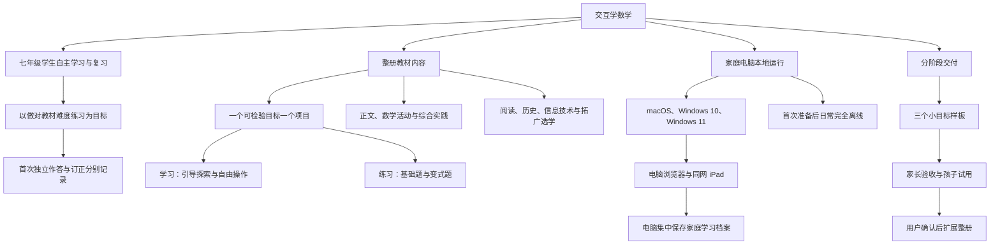

# 交互学数学：已确认需求基线

状态：用户已于 A27 确认需求基线，并于2026-10-23确认试运行成功、样板测试通过。第一阶段验收通过，第二阶段按依赖分批扩展。本文及关联项目表、验收方案构成需求基线；后续细节调整须保持学习目标与覆盖关系一致。

整理日期：2026-10-22；最后更新：2026-10-24。

## 1. 产品目标与使用者

面向正在学习本册教材的七年级学生，用于家庭自主学习和课后复习。学生通过可视化操作学习知识，再通过教材难度的练习检验能否做对题。

核心目标是练习表现。交互、趣味情境和短说明共同帮助学生完成题目；完成动画或拖动操作本身不等于练习达标。

每个项目围绕一个明确、可练习检验的目标，分为“学习”和“练习”两个部分。相关项目可以共用画板或交互模型，各自保留目标、练习和结果。

## 2. 需求决策树

## 3. 教材范围与内容组织

依据用户提供的[教材 PDF](/Users/zhenyu/dev/Interactive_Mathematics_Learning/textbooks/（根据2022年版课程标准修订）义务教育教科书·数学七年级上册--540ac93d.pdf)。本册目录为六章，另有两项综合与实践。内容表中的页码均为教材印刷页码，正文对应 PDF 页序为印刷页码加 7。

| 内容层级 | 完整计划中的处理方式 |
| --- | --- |
| 正文概念、性质、法则、方法及核心应用 | 分解为可检验的小目标，逐项配置交互学习和练习 |
| 章后数学活动 | 纳入完整计划，保留数学目标，改编为适合家庭使用的操作与任务 |
| 进位制、运动会场地设计两项综合实践 | 纳入完整计划，按子目标组织，最后汇合成实践任务 |
| 数学思想与方法 | 映射到具体项目，例如数形结合、归纳、转化、类比和建模 |
| 阅读、数学史、信息技术、习题独有拓广内容 | 在清单中标为选学，核心内容完成后扩展 |
| 教材习题 | 用于确定题型和难度，选择代表性任务设计同型题与变式题 |

知识点项目是产品拆分建议，不等同于教材节数。相同知识在正文、例题、练习和小结中重复出现时只登记一次；不同情境可作为同一项目的变式。

完整项目表见[整册项目拆分索引](/Users/zhenyu/dev/Interactive_Mathematics_Learning/docs/knowledge-map.md)。

## 4. 学习体验

### 4.1 导航

- 按教材章节组织目录，同时允许直接进入任意已上线知识点。
- 展示本项目的学习目标、教材位置及必要前置知识。
- 前置项目已上线时提供补学入口；尚未上线时提供简短回顾，避免出现无效链接。
- 保留“继续上次学习”和从错题返回对应知识点的入口。

### 4.2 一个项目的学习部分

默认采用“提出小问题 → 引导操作 → 观察结果 → 规则与示例”的流程，允许自由操作和重置。

| 环节 | 要求 |
| --- | --- |
| 学习目标 | 用学生能理解的短句说明学完应会做什么 |
| 小问题 | 引出当前目标，鼓励先预测，再操作验证 |
| 操作 | 拖动、拼搭、改变参数、选择或模拟；图形、符号、数值之间保持一致 |
| 观察 | 关键变化即时可见，需要时突出有关量和对应关系 |
| 规则与示例 | 保留简短规则、关键条件和一个代表性示例，方便复习 |
| 自由探索 | 学生可改变条件、重复观察，并恢复初始状态 |
| 进入练习 | 进入本目标的独立练习，保留题目必要图形，撤去教学过程中的答案辅助 |

视觉风格清爽、适合初中生，文字与公式清楚。趣味主要来自数学操作、生活情境和即时反馈，配少量完成成就提示。

## 5. 练习与评价规则

### 5.1 题型与难度

题目难度对齐本册教材，覆盖基础、常见变式及适量综合应用。每个项目使用适合该目标的题型：选择、判断、填空、交互操作、关键步骤补全、选择下一步、列数量关系或列式。

计算、求值、解方程和应用题可搭配最终答案题与结构化步骤题。图形操作题按照题目要求检验操作结果。不同题型均须有明确判分规则、提示与解析。

每轮默认 5 题，其中 3 道基础题、2 道变式题。题目由审核过的题型模板和受约束的参数产生；“再来一组”提供新的同类题。题目保存确定的参数与内容版本，以便原题重做。

### 5.2 首次独立作答

一题只有同时满足以下条件，才计入当轮独立答对数：

1. 首次正式提交正确。
2. 提交前未使用本题提示或解析。

5 题中至少 4 题首次独立答对，显示“本轮达标”。首次答错后的订正、使用提示后答对、查看解析后完成分别标识，不改写当轮首次作答成绩。

空白或无法解析的输入先提示填写格式，不视为一次可判分答案；拖动过程不自动视为提交。应用依据自身记录的作答、提示和解析使用情况统计，不推断应用外是否有人帮助。

“本轮达标”描述这轮练习结果，不直接标记为长期掌握。知识点可展示最新练习、历史达标情况与继续练习入口。

### 5.3 答错与求助

提交后立即反馈。答错先给针对性提示，允许重试；学生也可以主动查看分步解析。解析应对应当前题目参数，说明关键规则和容易出错的位置。

每轮结束后，学生自由选择返回学习、订正错题或再来一组；达标后也可以继续练习。没有必须完成的强制刷题循环。

### 5.4 判分细则的设计责任

- 接受题目允许的等价答案、多个正确结果和合理的书写顺序。
- 同时检查目标要求的答案形式。例如要求“合并同类项”时，未合并的原式即使数值等价，也不算完成目标。
- 分数、小数、单位、精确度和代数式形式按题目约定处理；近似值不自动代替题目要求的精确值。
- 几何操作按关系或测量要求判定，触控容差与吸附规则由题目明确配置；图形朝向或绘制位置不应造成数学上正确的答案被误判。
- 变式参数、干扰项、提示措辞和数学边界由内容作者核对，不要求家长逐题制定。

## 6. 学习记录与家庭档案

运行项目的电脑是记录的主要存放位置。同一学生使用电脑或同网 iPad 时，访问同一份进度与错题。

提供简单家庭学习档案，无需注册；默认一个档案，可以添加和切换。不同档案的进度与错题独立。

| 记录 | 至少保留的内容 |
| --- | --- |
| 学习位置 | 档案、项目、最近学习位置与更新时间 |
| 每轮练习 | 项目、题目快照或可复现参数、首次作答、正确与否、提示/解析使用、订正过程、轮次结果 |
| 错题 | 原题、原作答、解析、提示使用、订正状态与重做结果 |
| 项目表现 | 最近练习、历史本轮达标情况及继续学习位置 |

错题订正后保留记录并更新状态，便于后续复习。原题重做单独显示复习结果；“再来一组”使用新题并建立新的五题轮次。两者均不覆盖原轮首次表现，原错题重做不混入新题轮次的达标统计。内容更新后，旧错题仍能按原题条件重现。

工程实现应保证刷新、重启和应用更新后数据保留，重复提交不重复计分，切换档案不混合记录。保存失败或电脑连接中断时明确告知当前状态，不显示未经确认的保存成功。具体存储与数据保护方式在技术方案中落实。

## 7. 本地运行与设备要求

- 首版同时支持 macOS、Windows 10 和 Windows 11。
- 提供双击启动入口，显示电脑访问地址、同网 iPad 访问地址和二维码。
- 学习期间，运行项目的电脑保持开机和程序运行；iPad 与它处于可互相访问的家庭网络。
- 首次安装准备完成后，教学内容、图片、字体、公式、交互、练习及记录均可不依赖外网使用。
- 电脑、iPad 为主要体验设备；手机完成基本学习和答题的适配属于基础适配要求。
- 必要资源随项目提供；首次安装准备和各平台打包方式由后续技术方案确定，日常启动不要求家长输入开发命令。

工程验证拟覆盖 macOS 的 Safari/Chrome、Windows 10/11 的 Edge/Chrome 及 iPad 的 Safari，并记录实际测试版本。用户已确认试运行成功；本次确认未细分设备与浏览器版本，各平台的逐项兼容性结论仍以实际记录为准。

电脑集中保存表示同一运行电脑上的共享；macOS 与 Windows 兼容本身不代表不同电脑之间自动同步。

## 8. 页面与流程方案

以下为需求对应的页面方案，具体布局在样板开发中落实：

| 页面或入口 | 主要内容 |
| --- | --- |
| 家庭学习入口 | 当前档案、继续学习、教材目录、错题复习 |
| 教材目录 | 章节、知识点、上线状态、前置提示、练习结果 |
| 知识点 | 目标、学习与练习两个部分、规则示例、自由探索 |
| 练习过程 | 题目、提交、即时反馈、提示、解析及当前进度 |
| 本轮结果 | 首次独立正确数、达标结果、订正情况、三种后续入口 |
| 错题复习 | 原题重做、订正状态、对应知识点入口 |
| 电脑启动入口 | 启停状态、本机地址、平板访问地址、二维码与简短说明 |

## 9. 交付阶段

### 第一阶段：三个完整样板

| 项目 ID | 样板 | 范围 |
| --- | --- | --- |
| N-NEG-COMP | 两个负数谁更大 | 比较两个负有理数的大小 |
| A-LIKE-COMBINE | 合并同类项 | 合并已给定的一组同类项，系数相加且字母与指数不变 |
| G-BISECTOR-CALC | 角平分线与角度 | 已知平分关系，由整个角或其中一半求相关角度 |

第一阶段同时交付这些样板需要的学习、练习、反馈、记录、错题、家庭档案、离线资源以及电脑/iPad 本地访问流程。其他知识点以规划状态呈现，不计为已上线内容。

由家长检查可用性，孩子进行试用，观察学习前后同难度新题的作答变化和需要额外讲解的位置。验证方案见[首阶段验收与试用清单](/Users/zhenyu/dev/Interactive_Mathematics_Learning/docs/pilot-acceptance.md)。

第一阶段由用户确认后，才进入第二阶段。用户已于2026-10-23明确反馈“本项目试运行成功。样板通过测试。”，该阶段确认已完成。

### 第二阶段：按依赖扩展

依据整册项目表，建议按有理数与运算、代数式与整式、方程、几何的内容依赖逐批推进；数学活动和综合实践在所需前置内容具备后接入。该顺序是实施建议，可依据第一阶段反馈调整。

核心计划完成后，再扩展选学清单。具体排期、技术栈与各批次数量在开发方案中确定，本次不假定上线日期。

用户已在第一阶段验收通过后确认继续开发第二阶段第一批：C1-04、C1-05、C1-06、C1-07、C1-08，分别为数轴结构、数与点的对应、相反数、正负号化简及绝对值。范围与验证记录见[第二阶段第一批](phase2-batch1.md)。其余计划项目不因本批扩展而被标为已上线。

用户确认0.2.0运行成功并要求继续后，第二批补齐C1-01、C1-02、C1-03、C1-09、C1-10、C1-11，范围见[第二阶段第二批](phase2-batch2.md)。本批完成后第一章12个核心目标形成完整学习链；章数学活动与选学仍单列后续范围。

用户确认0.3.0运行成功并要求继续后，第三批开发C2-01—C2-07，覆盖有理数加减法、运算律分组、标准量加偏差求总量及数轴两点距离，范围见[第二阶段第三批](phase2-batch3.md)。第二章其余18个核心目标、数学活动与综合实践继续按计划扩展。

用户确认0.4.0运行成功并要求继续后，第四批开发C2-08—C2-14，覆盖两数乘法、倒数、乘法分组、乘积符号、分配律、除法和规范分数，范围见[第二阶段第四批](phase2-batch4.md)。第二章尚余11个核心目标，数学活动与综合实践继续按计划扩展。

## 10. 需求决策追溯

| 决策 | 对话依据 |
| --- | --- |
| 七年级学生自主学习/复习、以做对练习题为目标 | A1、A2 |
| 每个知识点学习与练习两部分；核心方法和综合实践完整覆盖 | A3 |
| 小规模样板验证后，用户确认再扩展 | A4、A14、A26 |
| 个人/家庭使用、电脑本地运行及同网平板访问 | A5、A13 |
| 一个可检验小目标一个项目、教材目录与自由选学 | A6、A7 |
| 引导探索、教材难度练习、即时反馈与分层帮助 | A8—A10 |
| 电脑/平板优先，手机基本适配，保留记录 | A11、A12 |
| 三个样板、选学范围、5题与4题达标规则、步骤题 | A14—A17 |
| 家庭档案、电脑集中保存、双击启动、离线使用 | A18—A20 |
| macOS 与 Windows 兼容 | 用户对 A21 的平台补充 |
| 清爽风格、首次独立作答口径、错题与再练流程 | Q22—Q24 的确认 |
| iPad、Windows 10 与 Windows 11 为实际设备范围 | Q25 的补充 |
| 孩子参加第一阶段试用 | Q26 的补充 |

## 11. 基线确认与变更

用户已在 A27 确认本文、整册拆分表与首阶段验收方案作为第一阶段开发依据，并于2026-10-23确认第一阶段试运行成功、样板测试通过。项目清单中的拆分粒度及交互设想允许在不遗漏教材目标的前提下调整；调整须同步更新对应练习与覆盖关系。进入第二阶段的用户验收条件已满足。

技术选型、打包细节、题型模板参数和具体画面属于后续设计与实现工作，不作为未回答的产品需求问题。第一阶段运行与样板测试已有用户通过确认；孩子的具体作答变化与学习效果尚未提供明细。

## 12. 学习陪伴精灵：已确认新增需求

用户于2026-10-24完成学习陪伴精灵的分轮需求讨论，并确认完整汇总可以定稿、记录到项目需求文档。详细范围、需求决策树、反馈规则、制作顺序及验收条件见[学习陪伴精灵需求基线](learning-companion.md)。

精灵采用用户已确认的初音 GLB 形象，在角落安静陪伴，通过动作、表情和简短中文气泡区分独立答对、答错、订正、提示后完成、查看解析及轮次结果。首版计划包含欢迎回来、主动求助、错题复习回应和轻触互动，支持电脑与同网 iPad、离线资源及静态立绘降级。

原有判题、首次独立作答、提示、解析与学习记录规则继续适用。按“静态人物确认 → 完整动作样板 → 用户与孩子试用 → 全项目接入”推进。用户于2026-10-24反馈灰模效果不理想，指定直接使用 `3D/hatsune_miku_v6.glb`，随后明确确认静态形象。当前七类独立动作样板已完成，表情细节仍在修整与复核；样板等待用户与孩子试用确认，尚未接入真实学习流程，演示不会提交答案或改变学习记录。详见[静态人物制作进度](companion-preview-progress.md)与[动作样板及验证边界](companion-motion-sample.md)。
